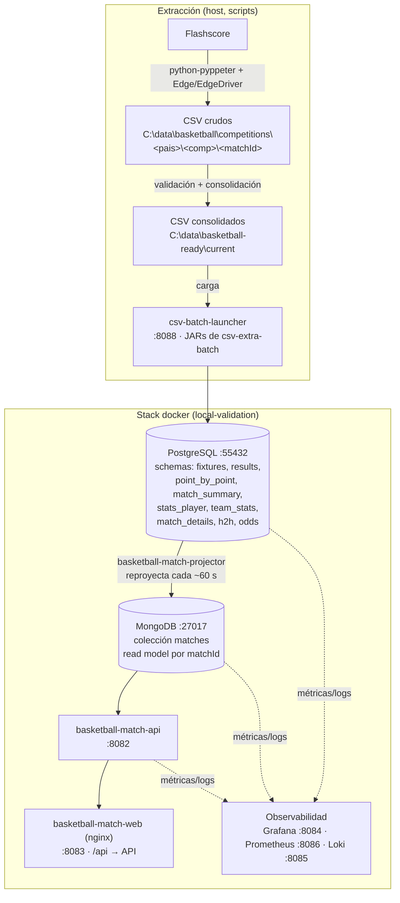

# Especificaciones del sistema Basketball

Guía única de cómo extraer datos (RESULTS y el resto de CSV), cargarlos, arrancar
la web, el procesamiento y la observabilidad (Grafana). Pensada para repetir el
flujo sin conocer el proyecto por dentro.

> Toda la configuración (rutas, puertos, credenciales, JDK) vive en
> `config\basketball.env` y la leen igual los `.bat`, los `.ps1` y los `.py`.
> Para cambios solo de esta máquina, crear `config\basketball.local.env` (fuera de git).

---

## 1. Arquitectura y flujo



Resumen en texto:

```text
Flashscore → (scraper) → CSV crudos → (consolidación) → CSV consolidados
  → (csv-batch-launcher) → PostgreSQL → (projector ~60s) → MongoDB
  → basketball-match-api → web
```

Dos tipos de información principales:

| Tipo | Qué es | Depende de |
|---|---|---|
| `FIXTURES` | Calendario (quién juega y cuándo) | rama independiente, no necesita resultado |
| `RESULTS`  | Marcador final + parciales por cuarto | base del resto |

A partir de `RESULTS` se añaden: `SCORE_SUMMARY`/resumen, `TEAM_STATS`,
`PLAYER_STATS` y `POINT_BY_POINT`.

---

## 2. Rutas y puertos (de `config\basketball.env`)

| Clave | Valor |
|---|---|
| Datos crudos | `C:\data\basketball\competitions\<pais>\<competicion>\` |
| Reports orquestador | `C:\data\basketball\reports\orchestrator\` |
| CSV consolidados (los que carga el launcher) | `C:\data\basketball-ready\current\` |
| Catálogo de ligas | `LIGAS_BASKET.json` |
| Scraper | `python-pyppeter\flashscore.py` (venv `.venv`) |
| Batch JARs | `csv-extra-batch\` |
| Navegador scraping | Edge + `.tools\msedgedriver\msedgedriver.exe` |
| Compose | `local-validation\docker-compose.yml` |

Puertos:

| Servicio | URL / puerto |
|---|---|
| Web | http://localhost:8083 |
| API | http://localhost:8082 |
| Launcher (carga CSV) | http://localhost:8088 |
| Auditoría fixtures | http://localhost:8090/fixtures-processing-audit |
| Grafana | http://localhost:8084 (admin / `local-dashboard-admin`) |
| Prometheus | http://localhost:8086 |
| Loki | http://localhost:8085 |
| PostgreSQL | localhost:55432 (db `basketball`, user/pass `test`/`test`) |
| MongoDB | localhost:27017 |

Contenedor de Postgres: `local-validation-postgres-1`.

Interruptores útiles del `.env`:
- `INICIO_RESULTS=1` → en el arranque automático, extrae RESULTS de todas las ligas.
- `CICLO_RESULTS=1` → en el ciclo diario, extrae RESULTS antes de procesar pendientes.
- `FILTRO_PAIS` / `FILTRO_COMPETICION` → limitan el orquestador.

---

## 3. Requisitos

- Docker Desktop abierto.
- JDK 21 (`C:\Program Files\Eclipse Adoptium\jdk-21.0.12.101-hotspot`). Todos los
  batch requieren Java 21; con Java 17 fallan.
- Maven en PATH.
- Python del scraper en `python-pyppeter\.venv`.
- Microsoft Edge + EdgeDriver (`scripts\arranque\ACTUALIZAR_EDGEDRIVER.ps1` lo actualiza).

Comprobación rápida:

```powershell
docker version
& 'C:\Program Files\Eclipse Adoptium\jdk-21.0.12.101-hotspot\bin\java.exe' -version
mvn -version
```

---

## 4. Arrancar todo

### 4.1 Web y servicios de lectura (stack docker)

Desde `C:\Develop\basketball\local-validation`:

```bash
docker compose up -d --build mongo basketball-match-projector basketball-match-api basketball-match-web
```

Levanta: `mongo`, `basketball-match-projector`, `basketball-match-api`,
`basketball-match-web` (y `postgres` si no estaba). Solo esos 5 servicios reales
quedan en el compose.

### 4.2 Procesamiento de CSV (launcher)

El `csv-batch-launcher` NO está en el compose. Carga en Postgres los CSV de
`C:\data\basketball-ready\current`. Desde `C:\Develop\basketball`:

```bash
cmd //c "scripts\arranque\ASEGURAR.bat launcher"
```

`ASEGURAR.bat` acepta varios servicios a la vez; los nombres válidos son:
`antibloqueo watcher docker postgres runtime auditoria launcher grafana navegador consumo`.

### 4.3 Observabilidad (Grafana + Prometheus + Loki)

Lanzador canónico (levanta data stores y toda la observabilidad):

```powershell
.\local-validation\scripts\Start-BasketballLocal.ps1
```

O solo Grafana + dashboard de pendientes (reimporta el dashboard):

```bash
cmd //c "1_EJECUTAR\GRAFANA_PENDIENTES.bat"
```

Grafana queda en http://localhost:8084 (admin / `local-dashboard-admin`).

### 4.4 Arranque automático completo

`1_EJECUTAR\AUTOMATICO_INICIO.bat` (lo lanza la tarea programada al iniciar sesión):
arranca Docker y todos los servicios, abre Grafana + dashboard de pendientes, y
—solo si `INICIO_RESULTS=1`— extrae RESULTS y procesa pendientes.

---

## 5. Extraer RESULTS (marcadores) de las ligas

El catálogo está en `LIGAS_BASKET.json`. Ligas disponibles:

| Code | país/competición | Code | país/competición |
|---|---|---|---|
| EUROLIGA | europe/euroleague | LEGA_A | italy/lega-a |
| ACB | spain/liga-endesa | LNB | france/lnb |
| NBA | usa/nba | BBL | germany/bbl |
| BSL | turkey/super-lig | LKL | lithuania/lkl |
| GBL | greece/basket-league | KLS | serbia/superleague |
| WINNER | israel/winner-league | | |

### 5.1 Orquestador por liga (recomendado)

```text
1_EJECUTAR\LIGAS_ORQUESTAR.bat [ALL|EUROLIGA|NBA|ACB|...] [results|datos|todo] [limite]
```

- `results` → solo marcadores (RESULTS).
- `datos` → el resto de CSV (point-by-point, team-stats, player-stats).
- `todo` → ambos.
- `limite` → nº de partidos (opcional).

Ejemplos:

```bash
cmd //c "1_EJECUTAR\LIGAS_ORQUESTAR.bat EUROLIGA results"
cmd //c "1_EJECUTAR\LIGAS_ORQUESTAR.bat ALL results"
```

Antes de orquestar asegura: `antibloqueo postgres launcher navegador`.

### 5.2 Todas las ligas / menú

```bash
cmd //c "1_EJECUTAR\LIGAS_RESULTADOS.bat"        # menú interactivo
cmd //c "1_EJECUTAR\LIGAS_RESULTADOS.bat <args>" # todas las ligas (EJECUTAR_TODAS_LAS_LIGAS.ps1)
```

### 5.3 Qué produce

RESULTS crudos en `C:\data\basketball\competitions\<pais>\<competicion>\<matchId>\`,
que tras consolidarse pasan a `C:\data\basketball-ready\current\` y los carga el
launcher en `results.results`.

> Nota: el CSV `RESULTS_*.csv` lleva la hora (`eventTime`); `SCORE_SUMMARY_*.csv`
> NO. Si un partido se rellena solo desde SCORE_SUMMARY, `results.event_time`
> queda vacío y la web (filtro `status=finished`, que exige `result.eventTime`) no
> lo muestra. Backfill de rescate en
> `sql\consultas\2026-11-07_1830_results-sin-event-time-no-salen-en-web.sql`.

---

## 6. Extraer el resto de CSV (stats y jugadas)

Tras tener RESULTS, se extrae el detalle. Flujo guiado para una competición:

```text
1_EJECUTAR\DATOS_EUROLIGA.bat [pais] [competicion] [limite]
```

Opciones del menú: `[1] POINT_BY_POINT`, `[2] TEAM_STATS`, `[3] PLAYER_STATS`
(cada una extrae e importa). Por debajo usa, por dataset:

| Dataset | Extraer | Importar |
|---|---|---|
| Jugada a jugada | `scripts\extraer\EXTRAER_POINT_BY_POINT.bat <pais> <comp> [lim]` | `scripts\importar\IMPORTAR_POINT_BY_POINT.bat <pais> <comp>` |
| Estadísticas de equipo | `scripts\extraer\EXTRAER_TEAM_STATS.bat <pais> <comp> [lim]` | `scripts\importar\IMPORTAR_TEAM_STATS.bat <pais> <comp>` |
| Estadísticas de jugadores | `scripts\extraer\EXTRAER_PLAYER_STATS.bat <pais> <comp> [lim]` | `scripts\importar\IMPORTAR_PLAYER_STATS.bat <pais> <comp>` |
| Resumen de marcador | `scripts\extraer\EXTRAER_MATCH_SUMMARY.bat <pais> <comp> [lim]` | (vía launcher) |
| Dataset genérico | `scripts\extraer\EXTRAER_DATASET.bat ...` | |

También con el orquestador: `LIGAS_ORQUESTAR.bat <LIGA> datos`.

---

## 7. Procesar pendientes y ciclo diario

### 7.1 Procesar todos los partidos pendientes

```text
1_EJECUTAR\MATCHIDS_PENDIENTES.bat [csv_seleccion] [limite]
```

Consulta la auditoría global y procesa solo los `matchId` pendientes
(extrae + importa lo que falte de cada partido). Asegura antes:
`antibloqueo postgres auditoria launcher navegador`.

### 7.2 Procesar los últimos partidos (completo)

```bash
cmd //c "1_EJECUTAR\ULTIMOS_PARTIDOS.bat"
```

### 7.3 Ciclo diario (lo que corre la tarea programada)

```bash
cmd //c "1_EJECUTAR\CICLO_DIARIO.bat"
```

1. (si `CICLO_RESULTS=1`) extrae RESULTS de todas las ligas.
2. `MATCHIDS_PENDIENTES` → procesa pendientes.
3. `ARCHIVAR_CSV_REPETIDOS` → deja un CSV vigente por partido/dataset, el resto al histórico.
   Log en `C:\data\basketball\reports\orchestrator\ciclo-diario-<fecha>.log`.

### 7.4 Vigilancia de servicios

```text
1_EJECUTAR\VIGILAR_SERVICIOS.bat [minutos] [servicio...]
```

Por defecto cada 5 min revisa `antibloqueo postgres auditoria launcher grafana` y
arranca lo que esté parado. `VIGILAR_SERVICIOS.bat una-vez` hace una sola pasada.

---

## 8. Verificar

```bash
# Web y API
curl http://localhost:8083/
curl http://localhost:8082/actuator/health          # 200

# Cargas del launcher (deben salir COMPLETED / exit_code 0)
docker exec -i local-validation-postgres-1 psql -U test -d basketball -c \
  "SELECT batch_type, status, exit_code FROM public.batch_launch_request ORDER BY created_at DESC LIMIT 15;"

# Datos por partido (sustituir <MATCH_ID>)
docker exec -i local-validation-postgres-1 psql -U test -d basketball -c \
  "SELECT match_id, home_team, away_team, home_score, away_score FROM results.results WHERE match_id='<MATCH_ID>';"
```

Tras cargar CSV, la web tarda ~1 min en reflejarlo (Postgres → projector → Mongo).

Schemas de Postgres y su contenido:

| Buscas… | Schema.tabla |
|---|---|
| Calendario | `fixtures.fixtures` |
| Resultado y parciales | `results.results` |
| Resumen de marcador | `match_summary.match_summary` |
| Estadísticas de equipo | `team_stats.team_stats` |
| Estadísticas de jugadores | `stats_player.stats_player` |
| Jugada a jugada | `point_by_point.point_by_point_event` |

> Toda consulta SQL que se ejecute contra la BD se guarda en `sql\consultas\`
> (ver la sección correspondiente en `CLAUDE.md`).

---

## 9. Mapa de scripts

- `1_EJECUTAR\` — scripts de uso diario (los de arriba).
- `scripts\arranque\` — `ASEGURAR.bat`/`ASEGURAR_SERVICIOS.ps1`, tareas programadas
  (`TAREA_INICIO`, `TAREA_DIARIA`, `TAREA_VIGILANCIA`), antibloqueo, EdgeDriver.
- `scripts\ligas\` — orquestación de ligas (`ORQUESTAR_LIGAS.ps1`,
  `EJECUTAR_TODAS_LAS_LIGAS.ps1`, `PROCESAR_ULTIMOS_PARTIDOS_COMPLETO.ps1`).
- `scripts\extraer\` — extracción por dataset.
- `scripts\importar\` — importación por dataset a Postgres.
- `scripts\pendientes\` — auditoría/procesado de pendientes y archivado.
- `scripts\monitor\` — watchers de imports/consumo.
- `python\orchestrate_competition.py` — orquestador de una competición (extrae,
  audita, recupera incompletos, consolida y publica). Ver `README.md`.

---

## 10. Notas

- El procesamiento real lo hace `csv-extra-batch` (JARs + `csv-batch-launcher`).
  Los antiguos microservicios Kafka (`*-parser`, `*-persistence`, `csv-watcher`,
  `csv-match-normalizer`, `file-event-router`) se eliminaron del compose y ya no se usan.
- No ejecutar `docker compose down -v`: borra el volumen de Postgres y todos los datos.
- No cargar CSV crudos a mano en `basketball-ready\current`: deben consolidarse antes.
- Puerto de Postgres desde Windows: `55432` (no `5432`).

---

## 11. SCORE_SUMMARY con identidad de partido (igual que RESULTS)

### Problema que resuelve

Un partido finalizado puede acabar en `results.results` por dos vías:

- Desde el CSV `RESULTS_<ts>_<pais>_<comp>.csv`, que trae `eventTime`,
  `eventDatetime` y (en el nombre) país/competición.
- Desde el CSV `SCORE_SUMMARY_<ts>_<matchId>.csv`, que **antes** solo traía
  marcador y parciales, sin hora ni país/competición.

Cuando un partido se rellenaba solo desde SCORE_SUMMARY, `results.event_time`,
`country` y `competition` quedaban vacíos. Y como la API considera "finished"
solo si `result.eventTime` no está vacío ([MatchServiceImpl.java:49](../basketball-match-api/src/main/java/com/fernandez/basketball/matchapi/match/service/MatchServiceImpl.java:49)),
esos partidos **no salían en la web** aunque estuvieran en Mongo con marcador.

### Qué hace ahora

SCORE_SUMMARY lleva los **mismos campos de identidad** que RESULTS. Columnas
añadidas al contrato (al final, sin mover las 15 originales):
`eventTime, eventDatetime, homeTeam, awayTeam, homeScore, awayScore, country, competition`.

Flujo de los nuevos campos:

```text
Página del partido (Flashscore)
  .duelParticipant__startTime  "06.11.2026 20:45"
        │  capture_html -> record score_datetime
        ▼
score_rows (extract_flashscore_match_bundle.py)
  - eventDatetime = parse_flashscore_datetime(...)  -> 2026-11-06T20:45:00+01:00
  - eventTime     = HH:MM                            -> 20:45
  - homeTeam/awayTeam/homeScore/awayScore            -> de las filas home/away
  - country/competition                              -> de la ruta .../competitions/<pais>/<comp>/
        ▼
SCORE_SUMMARY_*.csv (23 columnas)
        │  csv-batch-launcher -> JAR match-summary
        ▼
results.results  (event_time, event_datetime, country, competition, ...)
        ▼  projector -> Mongo -> API -> web
```

### Detalle técnico

- **Scraper** (`python-pyppeter`):
  - `csv_contracts.py` → `SCORE_SUMMARY_FIELDS` ampliado.
  - `extract_flashscore_match_details.py` → `capture_html` emite el record
    `score_datetime` leyendo `.duelParticipant__startTime`.
  - `extract_flashscore_match_bundle.py` → `score_rows` parsea la fecha con
    `parse_flashscore_datetime` y rellena identidad en cada fila (home y away);
    país/competición se infieren de `--data-dir` (`.../competitions/<pais>/<comp>`).
- **Carga** (`csv-extra-batch/match-summary`):
  - `CsvInput.java` → acepta la cabecera ampliada (basta que empiece por las 15
    columnas originales).
  - `ResultRow.java` → acepta filas con ≥15 columnas y lee event_time/
    event_datetime/country/competition del row `home`.
  - `ResultsWriter.java` → el `INSERT`/`ON CONFLICT` a `results.results` ahora
    incluye `event_time, event_datetime, country, competition`, con
    `COALESCE(NULLIF(...,''), EXCLUDED...)` para rellenar vacíos sin pisar valores
    buenos ya existentes.

### Compatibilidad y red de seguridad

- Los `SCORE_SUMMARY_*.csv` antiguos (15 columnas) se siguen cargando: las
  columnas extra se tratan como ausentes (quedan nulas).
- Si el scrape de la hora fallara, el backfill desde `fixtures`
  ([sql/consultas/2026-11-07_1830_results-sin-event-time-no-salen-en-web.sql](../sql/consultas/2026-11-07_1830_results-sin-event-time-no-salen-en-web.sql))
  sigue disponible como rescate.

### Verificado

Probado de punta a punta con `juVOVk74` (Partizan 88-67 Maccabi): `country`/
`competition` pasaron de vacíos a `europe`/`euroleague` y `event_time` a `20:45`
en `results.results`, y se propagó a MongoDB y a la API. Pendiente: una
extracción real con Edge para validar el tramo Flashscore → CSV en la máquina.
