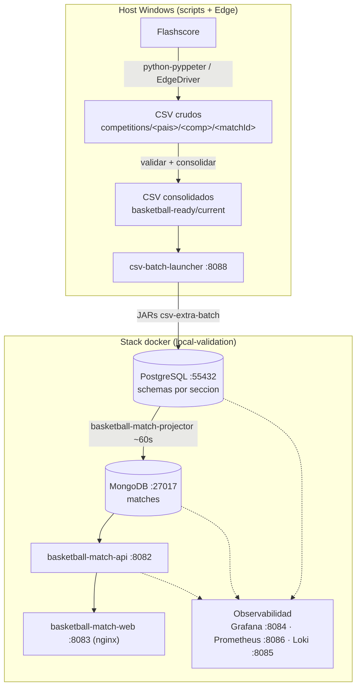

# SDD — Documento de Diseño Software · Basketball

> **Estado:** vivo · **Fecha:** 2026-11-07 · **Ámbito:** pipeline completo de datos de
> baloncesto (extracción → carga → read model → API → web) y su observabilidad.
>
> Documento de diseño. El **detalle operativo** (comandos exactos, puertos, cómo
> arrancar y extraer) está en [ESPECIFICACIONES.md](ESPECIFICACIONES.md); la guía
> de iniciación, en [../csv-extra-batch/START_HERE.md](../csv-extra-batch/START_HERE.md).

---

## 1. Introducción

### 1.1 Propósito
Describir la arquitectura y el diseño del sistema que obtiene datos de partidos de
baloncesto de Flashscore, los normaliza y persiste, construye un read model y los
expone en una web.

### 1.2 Alcance
Cubre: scraping, contratos CSV, carga batch a PostgreSQL, proyección a MongoDB, API
de lectura, frontend web, y la pila de observabilidad. No cubre el detalle interno de
cada parser de Flashscore ni el diseño visual del frontend.

### 1.3 Definiciones
| Término | Significado |
|---|---|
| CSV crudo | Fichero extraído por el scraper bajo `competitions/<pais>/<comp>/<matchId>/` |
| CSV consolidado | CSV validado y publicado en `basketball-ready/current/`, listo para cargar |
| Batch | Programa Java (JAR) que carga un tipo de CSV en PostgreSQL |
| Launcher | Servicio que detecta cada CSV y ejecuta el batch que le corresponde |
| Projector | Servicio que proyecta PostgreSQL → MongoDB (read model) |
| Read model | Documento por `matchId` en MongoDB que consume la web |
| `matchId` | Identidad de negocio del partido (de Flashscore), une todas las secciones |

### 1.4 Referencias
- [ESPECIFICACIONES.md](ESPECIFICACIONES.md) — operación y puertos.
- `CLAUDE.md` (raíz) — reglas de arranque y de consultas SQL.
- `LIGAS_BASKET.json` — catálogo de competiciones.

---

## 2. Visión general

El sistema es un **pipeline por lotes con read model**: source of truth en
PostgreSQL, vista materializada regenerable en MongoDB, y una API de solo lectura
para el frontend. La extracción se ejecuta en el host (Windows + Edge); el resto del
stack corre en Docker (`local-validation`).

---

## 3. Arquitectura

### 3.1 Componentes

| Componente | Repo/Carpeta | Tecnología | Responsabilidad |
|---|---|---|---|
| Scraper | `python-pyppeter/` | Python + Selenium (Edge) | Extraer CSV de Flashscore según contratos |
| Orquestador | `python/`, `scripts/`, `1_EJECUTAR/` | Python + .bat/.ps1 | Extraer, auditar, recuperar, consolidar, publicar |
| Launcher | `csv-extra-batch/launcher/` | Spring Boot | Cola en PostgreSQL; ejecuta el JAR por tipo de CSV |
| Batches | `csv-extra-batch/{results,match-summary,point-by-point,team-stats,stats-player,fixtures}` | Spring Batch | Cargar cada sección en su schema de PostgreSQL |
| Projector | `basketball-match-projector/` | Spring Boot | Unir secciones por `matchId` → documento en MongoDB |
| API | `basketball-match-api/` | Spring Boot (Mongo) | Exponer el read model al frontend (solo lectura) |
| Web | `basketball-match-web/` | Vite + nginx | Frontend; consume la API vía `/api` |
| Observabilidad | `local-validation/observability/` | Prometheus, Loki, Grafana, exporters | Métricas, logs y dashboards |

### 3.2 Principios de diseño
- **PostgreSQL = source of truth**; MongoDB = read model **regenerable** (si se
  borra, el projector lo reconstruye desde PostgreSQL).
- **Una sección = un schema = un batch** (fixtures, results, point_by_point,
  match_summary, stats_player, team_stats).
- **Contratos CSV centralizados** (`python-pyppeter/csv_contracts.py`): la cabecera
  es el contrato entre scraper y batches.
- **Identidad de negocio por `matchId`**: todas las secciones se unen por él.
- **Idempotencia**: los batches usan `ON CONFLICT (match_id) DO UPDATE`.

---

## 4. Flujo de datos

1. **Extracción** — el scraper visita Flashscore y escribe CSV crudos por partido.
2. **Auditoría/recuperación** — el orquestador detecta datasets incompletos y
   reextrae solo lo que falta.
3. **Consolidación** — publica un CSV vigente por partido/dataset en
   `basketball-ready/current/`.
4. **Carga** — el launcher detecta cada CSV y ejecuta el batch correspondiente, que
   escribe en el schema de PostgreSQL.
5. **Proyección** — el projector, cada ~60 s, descubre `matchId`, une las secciones y
   escribe/actualiza el documento en MongoDB.
6. **Exposición** — la API lee MongoDB; la web consume la API.

**Latencia web:** tras cargar un CSV, el cambio tarda ~1 min en verse (ciclo del
projector).

---

## 5. Modelo de datos

### 5.1 PostgreSQL (source of truth)
Base `basketball`, un schema por sección:

| Schema.tabla | Contenido |
|---|---|
| `fixtures.fixtures` | Calendario (equipos, fecha/hora) |
| `results.results` | Marcador final + parciales por cuarto + identidad |
| `match_summary.match_summary` | Resumen de marcador |
| `team_stats.team_stats` | Estadísticas de equipo |
| `stats_player.stats_player` | Estadísticas de jugadores |
| `point_by_point.point_by_point_event` | Jugada a jugada |

Otros schemas del projector: `match_details`, `h2h`, `odds`.

### 5.2 MongoDB (read model)
Colección `matches`, un documento por `matchId` con secciones: `fixture`, `result`,
`summary`, `players`, `teamStats`, `pointByPointEvents`, `availableSections`,
`eventDatetime`.

### 5.3 Contratos CSV
Definidos en `python-pyppeter/csv_contracts.py`. Los principales:
- `results.csv` — `matchId, eventTime, eventDatetime, homeTeam, awayTeam, homeScore, awayScore, home_score1..5, away_score1..5`.
- `score_summary.csv` — `match_id, side, team, team_url, total, home_score1..5, away_score1..5` **+** identidad (`eventTime, eventDatetime, homeTeam, awayTeam, homeScore, awayScore, country, competition`). Ver §8.
- `fixtures.csv`, `player_stats.csv`, `stats_all_periods.csv`, `point_by_point.csv`, `h2h.csv`, `odds_*.csv`.

---

## 6. Interfaces

### 6.1 API REST (`basketball-match-api`, `:8082`)
Base `/api/v1/matches`:
- `GET /` — listado paginado/filtrable (`country`, `competition`, `status`, `q`,
  `minPlays`, `maxPlays`, `page`, `size`, `sort`). `status=finished` exige
  `result.eventTime` no vacío + marcador.
- `GET /filters` — países y competiciones disponibles.
- `GET /{matchId}` · `/{matchId}/stats` · `/{matchId}/players` · `/{matchId}/point-by-point`.
- `GET /performances`.
- Procesamiento: `/{matchId}/processing`, `/processing/pending`, `/processing`.

### 6.2 Launcher (`:8088`)
`POST /batch-launches` encola una carga; `GET /batch-launches/{id}` consulta estado
(`QUEUED|RUNNING|COMPLETED|FAILED`). Tabla de cola: `public.batch_launch_request`.

### 6.3 Auditoría de fixtures (`:8090`)
`GET /fixtures-processing-audit/latest`, `/dataset-unavailable` (datasource Infinity
de Grafana).

---

## 7. Despliegue y operación

- **Stack docker**: `local-validation/docker-compose.yml` (servicios: postgres,
  mongo, projector, api, web; `python-pyppeter` bajo perfil `generator`).
- **Puertos**: web 8083, API 8082, launcher 8088, auditoría 8090, Grafana 8084,
  Prometheus 8086, Loki 8085, PostgreSQL 55432, MongoDB 27017.
- **Arranque** (ver ESPECIFICACIONES §4): `docker compose up -d ...` + `ASEGURAR.bat
  launcher`; observabilidad con `Start-BasketballLocal.ps1`.
- **Operación diaria**: `1_EJECUTAR/CICLO_DIARIO.bat` (extraer RESULTS + procesar
  pendientes + archivar). Extracción por liga: `LIGAS_ORQUESTAR.bat <LIGA> results|datos|todo`.
- **Requisitos**: Docker, JDK 21, Maven, Python (venv), Edge + EdgeDriver (versión
  del driver = versión de Edge).

---

## 8. Diseño destacado: identidad de partido en SCORE_SUMMARY

**Problema:** un partido podía entrar en `results` solo desde `SCORE_SUMMARY`, que no
traía hora ni país/competición → `results.event_time/country/competition` vacíos → la
API no lo marcaba `finished` → no salía en la web.

**Diseño:** `SCORE_SUMMARY` lleva los mismos campos de identidad que `RESULTS`. La
hora se captura de `.duelParticipant__startTime` de la ficha del partido y se parsea
con `parse_flashscore_datetime`; país/competición se infieren de la ruta de datos. El
batch `match-summary` acepta la cabecera ampliada (≥15 columnas) y escribe
`event_time, event_datetime, country, competition` en `results.results` con
`COALESCE(NULLIF(...,''), EXCLUDED...)` (rellena vacíos sin pisar valores buenos).
Detalle en [ESPECIFICACIONES.md §11](ESPECIFICACIONES.md).

---

## 9. Observabilidad

- **Métricas** (Prometheus): exporters de postgres, mongodb, cadvisor, blackbox;
  Prometheus en 8086.
- **Logs** (Loki): promtail lee los contenedores y envía a Loki (8085); etiquetas por
  `container`/`service`.
- **Dashboards** (Grafana 8084): set oficial = dashboards de `csv-extra-batch`
  (Postgres/Infinity), dashboard global de flujo, y uno por microservicio vivo
  (api, projector, web, mongo, postgres). Importación en `Start-BasketballLocal.ps1`.
- Datasources de Grafana: Prometheus, Loki, PostgreSQL (directo) e Infinity (auditoría).

---

## 10. Decisiones y trade-offs

- **Read model en Mongo** en vez de servir desde PostgreSQL: desacopla la web de la
  forma relacional y permite documentos listos para pintar; coste: latencia de
  proyección (~60 s) y duplicación de datos.
- **Batches autónomos por sección** en vez de un ETL único: aislamiento de fallos y
  reprocesado por sección; coste: más piezas y un contrato CSV que mantener.
- **Scraping con Edge en el host** (no en Docker): acceso a Flashscore con un
  navegador real; coste: depende del entorno Windows (Edge + driver compatibles).

---

## 11. Riesgos y deuda técnica

| Riesgo | Impacto | Mitigación / estado |
|---|---|---|
| Filtro `finished` atado a `result.eventTime` | Partidos con marcador pero sin hora no salen en la web | Resuelto en origen (§8) + backfill desde `fixtures` en `sql/consultas/` |
| Projector no proyecta el objeto `fixture` cuando `fixtures.event_time` es nulo | ~1337 "scheduled" sin equipos/fecha y sin filtrar por liga | **Cerrado** — eran docs obsoletos; `PROJECTION_VERSION` en el sourceHash fuerza reproyección (0 rotos; scheduled NBA 0→1068) |
| Exporters con `restart: "no"` | Se quedan `Exited` y los dashboards dejan de actualizarse | **Abierto** — poner `restart: unless-stopped` o `VIGILAR_SERVICIOS.bat` |
| `results` de euroleague con `country/competition` vacíos (SCORE_SUMMARY antiguos) | Dependen de la `fixture` para clasificarse | Resuelto para extracciones nuevas (§8) |
| Repos anidados (`python-pyppeter`, `csv-extra-batch`, `local-validation`) gitignorados y de otro propietario | Cambios fáciles de perder / no versionados con el repo raíz | Documentado; commitear en cada repo |

---

## 12. Verificación

Extremo a extremo validado con `juVOVk74` (Partizan 88-67 Maccabi): SCORE_SUMMARY con
identidad → `results.results` (country/competition/event_time) → MongoDB → API. Builds
Java en verde y suite del scraper sin regresiones. Pendiente: validar el tramo
Flashscore → CSV en una extracción real de liga completa.

## 13. Verificación continua (calidad / gates)

La verificación no es solo manual; está soportada por tres capas:

- **Script de verificación** `scripts/Verificar.ps1` (lanzador `1_EJECUTAR/VERIFICAR.bat`):
  convierte las comprobaciones de `VERIFICACION-SDD.md` en checks verde/rojo
  (web/API 200, sin slugs no canónicos, filtros limpios, join fixture+result). Código
  de salida 0/1, apto para hook o CI. Requiere el stack arrancado.
- **Hook `pre-push`** en cada subrepo (`.githooks/pre-push`): compila/typechea antes de
  permitir el push. Se activa una vez por repo con `git config core.hooksPath .githooks`.
- **CI en GitHub Actions** (`.github/workflows/ci.yml`) por subrepo: Maven `verify`
  (Java), `npm run build` + `npm test` (web), `unittest` (python), en cada push/PR.

Además, la skill de proyecto **`/normas-basketball`** recoge las convenciones de código
y el flujo SDD → plan → verificación.

Estado conocido: la API ya está en **verde** (M3); queda el scraper python con tests
fallando (ver §11 y `VERIFICACION-SDD.md`).
